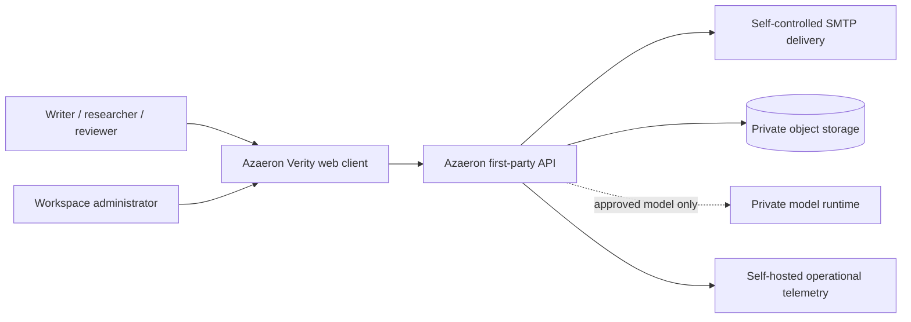
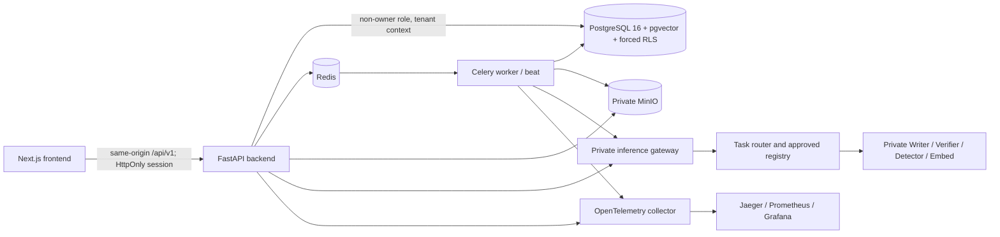

# 02 — Technical requirements

**Baseline:** integrated source `3c583aa0c29a419bea378e0cd2977c7f190c08bc`, migration `20260929_0039`, [captured OpenAPI](../evidence/spec-driven-20261011/openapi.json) and [live schema catalog](../evidence/spec-driven-20261011/schema-catalog.json). This document defines boundaries and target gates; the captures establish what currently exists. `ARCHITECTURE.md` and `docs/verity/INTEGRATION_MAP.md` remain implementation maps. Their older “no live inference server” statements are historical: DEV_ONLY MLX now works locally. No production model or GPU runtime is approved.

## C4 level 1 — system context

The trust boundary is the Azaeron API. Customer prompts, documents, embeddings and detector text must not go to OpenAI, Anthropic, Gemini, OpenRouter, external detector/embedding APIs or hosted inference fallback. SMTP is an identity service, not AI inference; the development Mailpit profile is loopback-only. No external corpus is represented as searchable until its rights and actual indexed coverage are recorded.

## C4 level 2 — containers and deployment

Current Compose files are [docker-compose.yml](../../../docker-compose.yml) plus generated isolated overrides from `backend/scripts/prepare_slice0_compose.py`. A separate migration owner runs Alembic; the application uses the non-owner runtime role. PostgreSQL and MinIO hold durable customer state; Redis is an operational queue/cache, not the authoritative record. Frontend never receives private runtime credentials. Production topology requires private subnets, mTLS gateway credentials, immutable image digests, admission records and deployed monitoring; no Kubernetes or L40S environment is certified. The Mac MLX endpoint at loopback port 18080 (container access via `host.docker.internal`) is **DEV_ONLY**, cannot be public, and is not an Azaeron-trained checkpoint.

## C4 level 3 — application components

| Boundary / owner | Source | Contract and failure behavior |
| --- | --- | --- |
| Auth, membership, API keys | `backend/app/modules/auth/`, `organizations/`, `api/v1/auth.py`, `identity.py`, `api_keys.py` | Session/MFA, active membership and scopes precede tenant reads and mutation. Revocation and rate limits fail closed. |
| Document/version storage | `modules/documents/`, `processing/`, `uploads/`, `api/v1/documents.py` | Upload request/confirm, hash-bound private object, immutable versions, source-specific extraction, worker status and safe editor append. |
| AI orchestration | `modules/agent/`, `api/v1/ai.py`, `api/v1/model_platform.py` | Durable run IDs, authorized typed tools, bounded context, SSE sequence, cancellation, receipt decision and reauthorization before release. |
| Model admission/serving | `modules/model_platform/`, `modules/inference/`, `config/models/registry.json` | Rights/lineage/release gates, hash-bound bundle, task route, mTLS private runtime and independent Verifier. Missing approval yields unavailable. |
| MeaningLock/edit | `modules/aegiswrite/`, `modules/verification/`, `modules/documents/editor.py` | Extract protected facts, one normal generation, deterministic check, independent semantic check, diff, explicit approval and append-only version. |
| Detection/similarity | `modules/detection/`, `modules/similarity/`, `api/v1/detection.py`, `similarity.py` | Detector abstention/calibration contract; workspace-scoped indexed overlap with source evidence and exclusion rules. |
| Quota/privacy/telemetry | `modules/billing/`, `modules/privacy/`, `api/v1/usage.py`, `privacy.py`, `telemetry.py` | Reserve/commit/release per operation, encrypted receipt, erasure fence and metadata-only logs/traces. |

## Required technical contracts

| ID | Contract and acceptance test |
| --- | --- |
| TRD-001 | Session or scoped API key → active user/org → row authorization; forced tenant RLS is defense in depth. Test IDOR, stale session and cross-tenant joins. |
| TRD-002 | Conversation/message/run/event IDs and `operation_id` are durable; SSE deltas are provisional, ordered, cancellable and followed by a final verified/unverified outcome. Test client disconnect and replay. |
| TRD-003 | Document Q&A pins `document_version_id`, content hash and authorized chunks; retrieval records offsets/coverage. Unsupported claims abstain. Test wrong-version and injection. |
| TRD-004 | MeaningLock protects dates, numbers, names, citations, quotations, negation and qualifiers before user presentation. No automatic accept on deterministic pass alone. |
| TRD-005 | Editor revisions use source hash, parent version and operation fingerprint; same operation replays its result, changed/stale request returns 409. Original bytes remain recoverable. |
| TRD-006 | Writer and Verifier have independent approved checkpoint hashes and base lineage; Writer cannot verify itself. Verifier outage produces UNVERIFIED/unavailable, never acceptance. |
| TRD-007 | Detector serves HUMAN/AI/MIXED/UNCERTAIN only with frozen CAL thresholds, validated-region policy and TEST/OOD evidence; UNCERTAIN has `probabilities: null`. |
| TRD-008 | Similarity runs only on enumerated indexed corpora. Evidence binds source version, span alignment, quote/citation context and exclusions; no misconduct decision. |
| TRD-009 | Upload request/confirm, object hash and immutable version creation are transactional/idempotent; extraction jobs and lifecycle states are explicit. |
| TRD-010 | Autosave/restore/revision use append-only versions, conflict detection and durable storage hash checks. |
| TRD-011 | Receipt binds actor, org, operation, input/candidate hashes, model/checkpoint/policy, retrieval/verification evidence and decision; erasure rules apply. |
| TRD-012 | Quota reserve/commit/release and API-key scope checks are concurrency-safe; request bounds and 429 Retry-After are enforced before costly work. |
| TRD-013 | Zero external AI egress; production gateway requires private address/mTLS, approved registry entry and exact runtime identity. DEV_ONLY cannot be promoted by config rename. |
| TRD-014 | Model states: BASELINE or TEST_ONLY (no product approval), DEV_ONLY local preview, CANDIDATE training/evaluation, APPROVED production. Rights, lineage, hash, training, evaluation, security, private runtime and independent approval are all mandatory. |
| TRD-015 | Each asynchronous/UI state has typed loading/empty/denied/uncertain/unavailable/error/retry/cancel results; no fabricated completion. |
| TRD-016 | Erasure fences current/future writes, deletes private objects, records receipt and replays tombstones before restored service is exposed. |
| TRD-017 | Public OpenAPI 3.1 `/api/v1` is versioned; auth/security, request/response and parameter schemas are compatibility-gated. Internal mTLS runtime protocol is not public. |
| TRD-018 | Measure representative p95/p99, TTFT, tokens/sec, RSS/GPU memory, error/cancellation and sustained load under frozen hardware/dataset/concurrency. No smoke result becomes an SLO. |
| TRD-019 | Agent tools are server-authorized, typed and bounded; document text is untrusted data, never a tool/policy instruction. No chain-of-thought request or recursive critique loop. |
| TRD-020 | Trust state is serialized in API/receipt and shown in UI; provisional, unverified, calibrated uncertainty and human acceptance remain distinct. |
| TRD-021 | Sealed rights-cleared Writer/Verifier/Detector/Embed datasets, two independent baselines and blinded dual review produce versioned raw outputs, hashes, confidence intervals and failure cases. |
| TRD-022 | Release requires exact-commit repository, security/image/SBOM, RLS/red-team, recovery, accessibility, load and model gates; any required FAIL/BLOCKED keeps production admission closed. |

**Model contracts.** Writer: bounded instruction/context, optional private VoiceLock, one normal generation, token/latency accounting and candidate output. Verifier: separate weights/base lineage, contradiction/number/date/entity/unsupported-addition and semantic-fidelity result; no acceptance if unavailable. Detector: four-state classification, abstention with withheld probabilities, calibration lineage and in-domain/OOD limits. Embed: private vectors with model hash/dimension, document-version/tenant binding, Recall@K/MRR/nDCG and latency benchmark before routing. All four are absent from the production registry. `config/model-platform/` defines candidate, dataset, training, bake-off and approval manifest schemas; unknown rights reject admission. A LoRA adapter is an Azaeron derivative only after a real Azaeron-controlled, rights-reviewed run creates a new hashed checkpoint and passes release gates. The existing Qwen checkpoint remains third-party.

**Concurrency and efficiency.** Quotas reserve before execution; jobs have idempotent operation IDs; workers recheck authorization and erasure fences. Bounded document chunks and selected history limit model context. Content hashes allow safe reuse of unchanged extraction/retrieval results. Prefix/KV caching and batching are production **targets**, not measured features. Use a smaller approved task model where evaluations justify it; do not ask the Writer to count, hash, parse or verify itself. No recursive critique/regenerate loop; a second generation is allowed only after a recorded failure. Async cancellation must release process permits and settle usage.

**Fault, privacy and threat model.** Validate URL/address allowlists against SSRF and DNS rebinding; reject runtime substitution and unapproved hashes; isolate tenant RAG at DB query and gateway boundaries; treat prompt/document/tool output as untrusted; bound upload size, decompression, context and stream duration; redact prompts/document text/secrets from logs. Threat tests include RLS/IDOR, quota races, cross-tenant retrieval, prompt injection, verifier bypass, cancel/retry and object-path traversal. Telemetry may carry IDs, durations and status, never customer bytes. Encrypt private objects and sensitive receipts; rotate keys and test restore. Existing local recovery is not offsite RPO/RTO evidence.

**Performance and operations.** Proposed application budget at concurrency eight on representative hardware: p95 document read/list/history/API-key read/admission/job poll ≤250 ms, revision save/conflict ≤1,000 ms, upload confirm ≤500 ms, zero unexpected 5xx. The prior 284-request/56-job local run met its 25 budgets but cannot certify production. Model TTFT/tokens-per-second/context/parallelism limits are **unset pending approved checkpoint and load evidence**. CI must record hardware, image/source digests, test fixtures, counts, latency distributions, scanner database version and failures. Rollback must restore prior approved images/registry pointer without changing immutable document versions; schema rollback requires a tested expand/contract sequence and backup/erasure replay.
