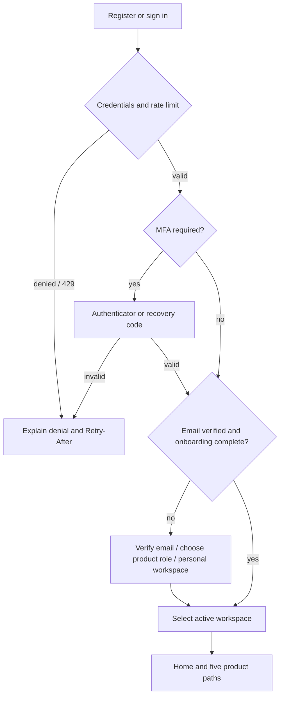
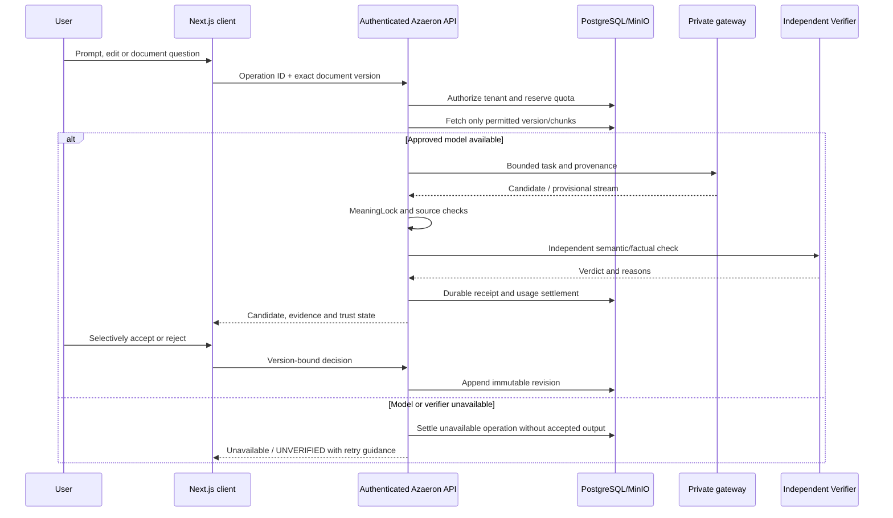
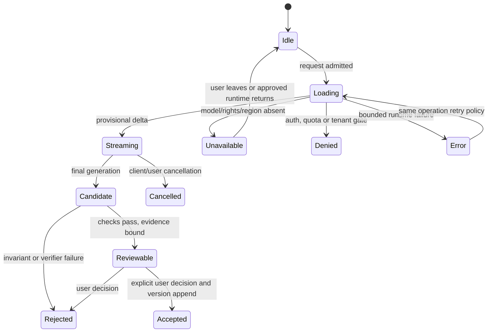

# 03 — Complete application flow

**Scope:** five products and their shared identity, workspace, usage, evidence and privacy journeys. Paths are based on [captured OpenAPI](../evidence/spec-driven-20261011/openapi.json) and the [integration map](../INTEGRATION_MAP.md). UI labels/states are specified in [04](04-UI-UX-DESIGN-BRIEF.md). `FLOW-*` IDs are stable traceability anchors. A missing approved model is an expected unavailable state, never an invisible success.

## Entry, identity and workspace (FLOW-001–003)

| Flow | Screen → endpoint → service → durable state → result, including exceptions |
| --- | --- |
| FLOW-001 registration/login/recovery | `/register`, `/login`, `/forgot-password`, `/reset-password`, `/verify-email` → `/auth/register`, `/login`, `/refresh`, `/forgot-password`, `/reset-password`, `/verification/*` → `auth.service`, `auth.identity`, `auth.mail` → `users`, `refresh_tokens`, `identity_tokens`, `identity_mail` → HttpOnly session or explicit 401/429/expired token. MFA enrollment/confirmation/recovery and session revocation use `/auth/mfa/*`, `/auth/sessions`; recovery codes display once. |
| FLOW-002 onboarding/workspace | `/onboarding`, Home workspace selector → `/auth/onboarding`, `/organizations`, `/organizations/{id}/select`, invitations/entitlements → `organizations.service`, membership checks → `organizations`, `memberships`, `users.last_active_organization_id` → active tenant context; denied/inactive membership never reuses a stale organization. |
| FLOW-003 settings/usage | `/settings` and API-key panel → `/auth/me`, `/api-keys`, `/usage`, `/organizations/{id}/entitlements` → auth key service and billing usage → `api_keys`, `usage_operations`, `usage_buckets` → scoped key shown once, usage from committed operations; quota denial returns 429/Retry-After, unavailable meter does not invent totals. |

## Create → verify → prove (FLOW-004–010)

| Flow | Screen → endpoint → service → durable state → result, including exceptions |
| --- | --- |
| FLOW-004 chat/stream | `/ai` conversation rail and composer → `/ai/conversations`, `/messages`, `/stream`, `/runs/{id}/cancel` (or stateless `/ai/chat`, `/ai/chat/stream`) → `agent.service/runner`, `model_platform` and `inference.gateway` → `ai_conversations`, `ai_messages`, `ai_runs`, `ai_events`, `usage_operations` → ordered provisional deltas and final status. Network disconnect/cancel stops work and settles quota. Production absence produces unavailable; DEV_ONLY Qwen output stays UNVERIFIED. |
| FLOW-005 document intake | `/documents`, `/check`, upload action in `/ai` → `/documents/upload-request`, scoped private PUT, `/upload-confirm`, `/jobs/{id}` → `uploads.service`, `documents.service`, `processing.service`, Celery → private MinIO, `documents`, `document_versions`, `jobs`, `processed_documents`, `document_chunks` → processing/completed/failed state. Hash, MIME, size and object existence failures stop confirmation; duplicate/lost response uses idempotent operation where supported. |
| FLOW-006 summary and grounded Q&A | `/ai` attached document or document detail → `/documents/{id}/summarize`, `/documents/{id}/ask` → `model_platform.document_generation`, retrieval, gateway → exact `document_versions`, authorized `document_chunks`, receipt/usage → summary with source coverage or answer with passage offsets; unsupported question abstains. A mismatched version, tenant or erased document is denied; injection text is treated as evidence, not instruction. |
| FLOW-007 Humaniser and review | `/humaniser`, `/write`, editor → `/aegiswrite/suggest`, `/refine`, model `/humanize`, `/ai/documents/{id}/receipts`, `/ai/receipts/{id}/decision` → `aegiswrite.service`, MeaningLock, agent receipts, independent Verifier → `aegis_edits`, `ai_action_receipts` → original/candidate/diff and explicit provisional or verified label. Failed invariant or missing verifier blocks acceptance; user can reject, edit or choose safe deterministic suggestions. |
| FLOW-008 editor autosave/restore | `/documents/{id}` editor → `/documents/{id}/revisions`, `/versions`, `/versions/{version}/restore`, `/download` → `documents.editor/service` → `document_versions`, private immutable objects, `provenance_events` → saved revision or 409 stale-parent conflict. Debounce, lost-response retry, undo/redo, offline draft and reload retain the original; restore appends a new version rather than rewriting history. |
| FLOW-009 AI detection | `/detector` → `/detection/documents/{id}`, `/explain` or approved-model `/detect` → detection service/private Detector → `detection_results`, `detection_segments`, `analysis_runs` → HUMAN/AI/MIXED/UNCERTAIN with limitations. Calibration/region failure returns UNCERTAIN with no probability; no misconduct conclusion. |
| FLOW-010 overlap review | `/plagiarism`, `/similarity`, document match view → `/similarity/corpora`, `/similarity/documents/{id}/analysis`, `/matches`, `/plagiarism/check` → similarity retrieval/ranking/review → `similarity_analyses`, `similarity_index_entries`, `similarity_matches`, source versions → aligned passages, source/version, quote/citation context and actual corpus scope. Empty corpus is an explicit coverage state; no web-wide result is fabricated. |

## Evidence, history and privacy (FLOW-011–014)

| Flow | Screen → endpoint → service → durable state → result, including exceptions |
| --- | --- |
| FLOW-011 reports/history | `/history`, document report and Advanced Analysis → `/reports/documents/{id}`, `/evidence/documents/{id}/graph`, `/citations/...`, `/authorship/...`, `/provenance/documents/{id}/timeline` → evidence/report/provenance services → version-bound findings, nodes/edges, citations, `provenance_events` → inspectable evidence with unavailable/insufficient dimensions. History must not infer events absent from storage. |
| FLOW-012 quota/retry/error | All product actions → operation admission, `/usage`, `/jobs/{id}` → billing reservation/settlement and worker retry → `usage_operations`, `usage_buckets`, `jobs`, `ai_runs` → 429 with `Retry-After`, bounded retry or terminal failure. Client retries reuse operation identity; server never charges twice for the same committed operation. |
| FLOW-013 account/document erasure | Settings privacy / erasure status → `/privacy/erasures`, `/privacy/erasures/{id}` → privacy service and worker → `privacy_erasures`, tenant rows and MinIO object deletion → pending/complete/failed receipt. Fence writes before deletion, replay erasures after backup restore and deny login to erased account; document archive via DELETE is not privacy erasure. |
| FLOW-014 export/proof | Document download, provenance export, receipt panel → `/documents/{id}/download`, `/provenance/documents/{id}/export`, `/ai/documents/{id}/receipts` → document/provenance/agent services → immutable object hashes, `provenance_exports`, `ai_action_receipts` → scoped downloadable artifact and evidence. Missing object/hash mismatch returns a failure, not a reconstructed proof. |

## State transitions and presentation obligations

**Loading** shows task and source version; **empty** says no conversations/documents/indexed corpus; **denied** explains authorization or quota without leaking row existence; **uncertain** withholds detector probability; **unavailable** names missing model capability without suggesting public fallback; **error** preserves draft and retry identity; **offline** stores an unsent local draft but cannot claim server save; **cancelled** retains prior committed content. Stream chunks are provisional and cannot be presented as independently verified until the final receipt says so. These states are testable via the `frontend/tests/` live suites and backend fail-closed tests; manual assistive-technology review remains a release task.
