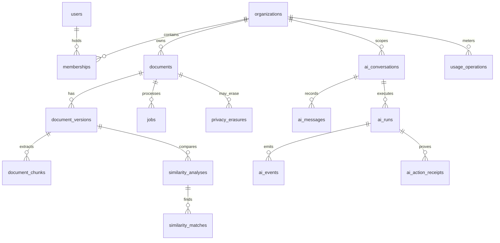

# 05 — Backend schema and API contract

**Observed schema, 2026-10-11.** The isolated PostgreSQL database reports Alembic head `20260929_0039`, **55 public tables**, **44 with enabled and forced RLS**, and 11 deliberately non-RLS control/global tables. The reproducible metadata-only query is [`scripts/verity_schema_catalog.sql`](../../../scripts/verity_schema_catalog.sql); its [captured catalog](../evidence/spec-driven-20261011/schema-catalog.json) is the exhaustive inventory of **every table, field, PostgreSQL type, nullability, default, constraint, index and policy definition**. It reads no rows or customer text. The [OpenAPI 3.1 capture](../evidence/spec-driven-20261011/openapi.json) is the exhaustive request/response/parameter schema for 90 paths and 104 operations. This document groups the catalog and defines invariants; if prose conflicts with the captured catalog, the catalog and current migration source win until this spec is corrected.

## Actual relational inventory

| Domain | Tables (all existing) | Key fields, constraints and ownership |
| --- | --- | --- |
| Identity and tenancy | `users`, `organizations`, `memberships`, `refresh_tokens`, `identity_tokens`, `identity_mail`, `api_keys` | String UUID IDs; membership joins actor↔organization with role/active; users hold verification/MFA/session version; refresh/API keys store digests; identity mail stores encrypted payload. Global identity tables are service-authorized rather than tenant-RLS tables; `api_keys` has tenant RLS. |
| Documents and jobs | `documents`, `document_versions`, `processed_documents`, `document_chunks`, `jobs`, `storage_relocations`, `storage_gc_progress` | Document `organization_id`, `owner_id`, `erasure_pending`; version `document_id`, `version_number`, `storage_path`, SHA-256, `previous_version_id`, `operation_id/fingerprint`; chunks include exact source offsets/hash and optional `embedding_vector vector(384)`. Objects live in private MinIO, not PostgreSQL. Version append is immutable; the catalog records unique/index/FK definitions. |
| Conversation, candidate and receipt | `ai_conversations`, `ai_messages`, `ai_runs`, `ai_events`, `ai_document_attachments`, `ai_tool_calls`, `ai_tool_results`, `ai_voice_profiles`, `ai_action_receipts` | All carry `organization_id`/`user_id` and forced RLS. Run operation/fingerprint/status, sequence-numbered messages/events, exact attachment version/hash and receipt input/candidate/result hashes bind a candidate to its decision. Receipt `verification`, `model_evidence`, `policy_revision` and `decision` are JSON/text fields, not proof that a production Verifier exists. |
| Editorial and usage | `aegis_edits`, `usage_operations`, `usage_buckets`, `billing_events` | Edits bind document/version/source hash and applied decision. Usage operations record org, user/key, task, operation fingerprint, reservation/settlement, tokens, response status and encrypted response receipt. `billing_events` exists but no paid billing readiness is asserted. |
| Detection, provenance and reports | `analysis_runs`, `detection_results`, `detection_segments`, `authorship_profiles`, `authorship_signals`, `integrity_reports`, `evidence_nodes`, `evidence_edges`, `provenance_events`, `provenance_exports`, `provenance_reports`, `audit_logs`, `compliance_reports` | Findings and events bind org/document/version/model/pipeline where applicable. Detection has abstention, calibrator and probability fields; they are not evidence of calibrated production predictions. Provenance before/after hashes and export hashes are versioned. |
| Similarity and citations | `similarity_analyses`, `similarity_index_entries`, `similarity_matches`, `claims`, `citations`, `citation_references`, `citation_sources`, `citation_findings` | Source/target version IDs, offsets, scores, method/evidence IDs and corpus/index state support an overlap review. Citation support, retrieval status and finding type are separate from a plagiarism judgment. All tenant evidence tables have forced RLS. |
| Governance and remaining workflow | `model_registry`, `evaluation_datasets`, `evaluation_examples`, `assignments`, `submissions`, `privacy_erasures`, `alembic_version` | Global model/evaluation metadata is admin-only and not tenant RLS; production serving also requires the separate `config/models/registry.json` approval policy. The isolated DB has one `EXPERIMENTAL` model metadata row, **zero approved production routes**. Evaluation records do not themselves grant data rights. Assignment/submission workflow exists as supporting legacy functionality. Erasure requests are tenant-RLS, with status/tombstone verification. |

The diagram shows main logical links, not every FK; the catalog contains exact FK and index definitions. `privacy_erasures` may target an account or organization as well as a document, so its diagram edge is conceptual. No new table is created by this specification.

## Tenant and transaction invariants

The 11 non-RLS tables are `alembic_version`, `evaluation_datasets`, `evaluation_examples`, `identity_mail`, `identity_tokens`, `memberships`, `model_registry`, `organizations`, `refresh_tokens`, `storage_gc_progress`, `users`. Their access is constrained through service roles and explicit membership/identity checks; “no RLS” does **not** mean public access. Every other observed table has both RLS enabled and forced; policies are listed per table in the catalog. Application queries still include organization/version predicates, and the runtime DB role is not the schema owner. Cross-tenant joins, direct object-key guesses and erased rows must be denied even if an API authorization check is missed.

Upload confirmation verifies object bytes/hash before durable version creation. Revision/restore holds an authorized document fence, checks base version and operation fingerprint, writes a new private object, appends `document_versions` and provenance, then settles usage. The same operation ID with the same payload replays its recorded result; changed payload or stale parent returns 409. Worker retries recheck erasure and document version. Quota reservation precedes model/worker work, with one terminal commit/release. No long model call holds a PostgreSQL transaction or document row lock. Recovery replays erasure tombstones before re-exposing a restored database and object store.

Object paths and encrypted receipt bodies are sensitive. Store only hashes/IDs/status in telemetry; never put prompt/document text in traces. API keys and refresh tokens remain digest-only at rest; one-time secrets are not returned in later list calls. Retention and encryption policy are in `docs/verity/PRIVACY.md` and the privacy module; commercial retention values require legal approval. Model/dataset manifests under `config/model-platform/` carry hashes, task rights, provenance and review records; they are **not** interchangeable with `evaluation_datasets` metadata rows. A future need for queryable lineage/calibration tables requires an approved use case and an additive migration; JSON manifests remain the current source of admission truth.

## Public API schemas and gaps

| Operation family | Existing request / success schema | Validation, authorization, failure |
| --- | --- | --- |
| `POST /ai/chat`, `/ai/chat/stream` | `ChatRequest`; successful payload/SSE currently lacks a full OpenAPI response schema | Auth + org + quota + model gate; stream deltas provisional, final state explicit. Define a typed response/SSE event contract before general developer GA. |
| `POST /humanize` | `HumanizeRequest` → `RefineResponse` | Writer/Verifier and MeaningLock; unavailable or unverified is not accepted content. |
| `POST /detect` | `RefineRequest`; 200 schema currently unspecified | Approved Detector/region; UNCERTAIN omits probabilities. Typed response is a contract gap. |
| `POST /plagiarism/check` | `PlagiarismRequest`; 200 schema currently unspecified | Authorized version/corpus; must state coverage. Typed response is a contract gap. |
| `POST /documents/{id}/ask`, `/summarize` | `AskRequest` or corresponding summary request; 200 schema currently unspecified | Exact version, tenant retrieval, Writer/Verifier. Typed response is a contract gap. |
| `POST /documents/upload-request`, `/upload-confirm` | `DocumentUploadRequest` → `DocumentUploadResponse`; confirmation → `DocumentResponse` | Bounded input, scoped PUT, hash/MIME/object confirmation and membership. |
| `POST /documents/{doc_id}/revisions` | `EditorRevisionRequest` → `DocumentVersionResponse` | `operation_id`, base version, text/edit IDs, source hash; 409 conflict. |
| `POST /privacy/erasures` | `ErasureCreate` → 202 `ErasureAccepted` | Password/MFA/explicit confirmation and scoped status receipt. |

The exact schemas, enum values, required properties, error responses and all other routes are in the captured OpenAPI. Pydantic validates typed requests; critical error envelopes and pagination are not uniform across every old endpoint. That is a documented GA gap, not silently declared compatible. Future API changes must keep the versioned path, compare structural request/response/parameter/security signatures in CI, and add an explicit migration/deprecation decision for breaking changes.

## Migration and rollback policy

Alembic files `backend/alembic/versions/20260826_0001_initial_schema.py` through `20260929_0039_agent_erasure_fence.py` form the current single head. Migration owner runs an **expand → backfill/verify → switch → contract** sequence for any future change. Add nullable columns/indexes first; backfill in bounded resumable batches under tenant/erasure fences; deploy readers compatible with old and new rows; then enforce constraints after shadow validation. Every migration must test upgrade from previous head, clean installation to head, rollback where logically safe, RLS/policy preservation, object hash consistency and backup/restore with post-backup erasure replay. A destructive drop or irreversible data rewrite requires a separate reviewed recovery procedure and is not authorized by this spec.

Current `model_registry` has metadata/provenance JSON but no immutable dedicated checkpoint-hash column or complete reviewer authority record. The target model promotion contract remains in hash-bound manifests and registry policy until a real approved checkpoint provides a tested migration case. Proposed future tables for lineage, verifier judgments or calibration are **not** created speculatively; the first real release candidate must justify fields, tenancy, retention and queries with a migration and restore test.
